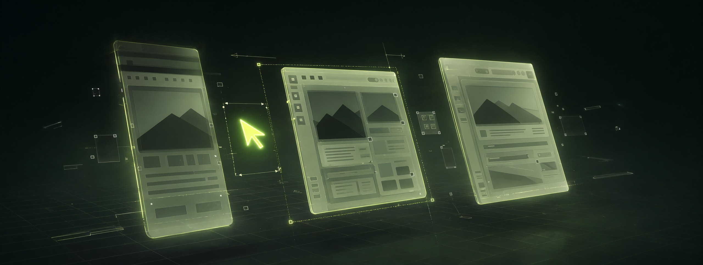
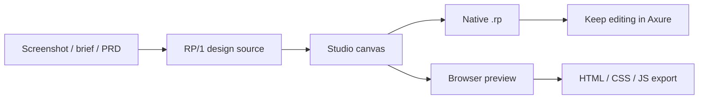
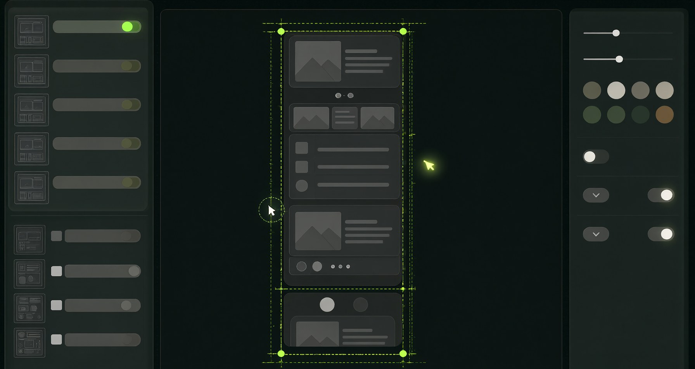

<div align="center">



<br>

# return_rp

### Give AI a canvas. Bring the design back to Axure.

Turn a screenshot, a brief or RP/1 source into a native `.rp` you can keep editing, not another prototype screenshot.

**Axure RP 9 / RP 11　·　AI-native canvas　·　CLI and MCP**

[](https://github.com/karlmoriaty/AxurePR-return-rp/releases) [](https://www.npmjs.com/package/return_rp) [](https://github.com/karlmoriaty/AxurePR-return-rp/actions) [](docs/version-parity.md) [](LICENSE)

[Get started](#quickstart)　·　[Workflow](#workflow)　·　[Studio](#studio)　·　[RP/1](#rp1)　·　[Version parity](#parity)　·　[FAQ](#faq)　·　[简体中文](README.md)

</div>

<br>

## In one sentence

> **AI drafts. You decide. Axure finishes the job.**<br>
> Pages, components, variables and interactions live in a versionable RP/1 source file, then compile into a native project.

| You give it | You get back |
| :--- | :--- |
| A screenshot, a brief, a PRD, or RP/1 source | A native `.rp`, a browser preview, HTML / CSS / JS export, and structure plus acceptance reports |

<br>

## Why it is not another UI generator

| | Most screenshot-to-code tools | **return_rp** |
| :--- | :--- | :--- |
| **Output** | HTML, images or a non-editable mockup | A native `.rp`, plus HTML / CSS / JS export |
| **Design source** | One-shot output that is hard to diff | RP/1 text source you can version and revise by layer |
| **Agent collaboration** | Often regenerates the whole page | Queries and edits by layer, semantics and scope |
| **Axure versions** | Usually one version | Bidirectional RP 9 / RP 11 parity |
| **Verification** | Look at a screenshot | Structure checks + browser interactions + Axure save/reopen and preview |

<br>

<a id="workflow"></a>

## One pipeline, from idea to Axure



1. **Write intent as source.** Screenshots go through the tracing pipeline; briefs and PRDs become RP/1 directly. Pages, components, variables and interactions stay in one text file.
2. **Refine on the canvas.** Your agent builds the first draft; you select, edit text and adjust layouts. Hand a local area back to the agent to explore another direction.
3. **Verify before delivery.** Real screenshots, interaction scenarios and structure checks run separately so navigation, states and save/reopen behavior are confirmed.
4. **Bring it into Axure.** Generate a native project, or export a browser-runnable build, and keep iterating.

<br>

<a id="studio"></a>

## Studio: a canvas both people and agents can edit



**AI drafts.** Author through RP/1 or commands; query layers and make targeted changes.<br>
**You refine.** Double-click text, Shift-drag a marquee, hold Option / Alt to measure, undo and redo.<br>
**Verify together.** Inspect real screenshots and exercise interactions before delivery.

[Studio workflow](docs/studio-design-workflow.md)　↗　[AI authoring](docs/studio-ai-authoring.md)　↗　[Acceptance layers](docs/studio-acceptance.md)

<br>

<a id="rp1"></a>

## RP/1: design intent has a source file

**RP/1** keeps pages, layout, components, variables and interactions together. Agents can target specific changes while the design keeps its structure, revision identity and a place to continue.

```text
rp/1 target=9 name="Next encounter" domain=mobile theme=mobile-hifi

page #home name="Discover" device=iphone-17-pro
  phone-shell #shell title="Meet your feathered neighbors." gap=16
    card #bird [fillxhug] title="Kingfisher" body="A flash of blue." actionText="Record" goto="notes"

page #notes name="Journal" device=iphone-17-pro
  phone-shell #shell title="My first field note" gap=16
    input #note [fillx44] value="I spotted it by the water today."
    button #back [fillx44] "Back to discovery" goto="home"
```

Grow a page into a complete flow, revise with `revise_prototype`, and merge supported native edits back into source.

[RP/1 reference](references/rp-language.md)　↗　[Examples](examples/authoring/mobile-cards.rp1)　↗　[Native roundtrip](docs/studio-native-roundtrip.md)

<br>

## Keep the design in your hands

| Continue in | What stays with you |
| :--- | :--- |
| **Studio** | A shared design document, transactions and undo history |
| **Axure** | Native objects and supported interactions to keep editing |
| **The browser** | Runnable previews, plus standalone HTML / CSS / JS export |

| Deliverable | Details |
| :--- | :--- |
| Native `.rp` | Targets RP 11 by default; use `target=9` or `AXURE_TARGET_VERSION=9` for RP 9 |
| Browser preview | Real interaction scenarios with clicks, navigation and state changes |
| Code export | Standalone HTML / CSS / JS for review or embedding |
| Structure and acceptance reports | Zero-error checks (zero unparseable records, dangling references and problems), browser assertions and Axure roundtrips recorded separately |

Pages, variables, dynamic panels and navigation ship together, alongside source, previews and verification reports.

[Native export and sync](docs/studio-native-roundtrip.md)　↗　[Code export](docs/studio-code-export.md)

<br>

<a id="parity"></a>

## RP 9 and RP 11, one pipeline

Both versions share the same CLI, MCP and Studio. Anything one version can do will not end as `unsupported` on the other; gaps are registered and either warn at runtime or fail with an explicit diagnostic before writing. Nothing is silently dropped.

| Capability | RP 9 | RP 11 |
| :--- | :---: | :---: |
| RP/1 native compilation and scene writing | Supported | Supported |
| Blank template detection, trimming and dynamic panel cloning | Supported | Supported |
| Native form widgets and state styles | Supported | Supported |
| Native repeaters and data operations | Supported | Supported |
| Core interactions, actions and adaptive views | Supported | Supported |
| Local Studio RP/1 authoring | Supported | Supported |
| Automatic Axure preview (Swift / PowerShell host) | Supported | Supported |
| Offline image-to-native generation | Supported | Supported |

Registered boundaries are limited to a few cases: RP 11 has no panel registration chain model; RP 9 has no matching structure for zoom anchors, toggle-enabled state, apply-style actions and RP 11-only events/functions, so those fail with explicit diagnostics; RP 9 filter combo types and delete-repeater-row-by-index are rewritten as equivalent rules and marked partial.

[Full capability matrix](docs/version-parity.md)　↗　[Capabilities and limits](references/capabilities.md)　↗　[Troubleshooting](references/troubleshooting.md)

<br>

<a id="quickstart"></a>

## Get started

| Dependency | Version | Purpose |
| :--- | :--- | :--- |
| Node.js | 18+ | CLI, MCP, Studio and tests |
| Python | 3.10+ | Native compilation and image processing |
| Axure | RP 9 or RP 11 | Native generation, save/reopen and automatic preview (optional) |

```sh
git clone https://github.com/karlmoriaty/AxurePR-return-rp.git
cd AxurePR-return-rp
python3 -m venv .venv
source .venv/bin/activate
python -m pip install -r requirements.txt
npm ci
```

Windows PowerShell:

```powershell
git clone https://github.com/karlmoriaty/AxurePR-return-rp.git
cd AxurePR-return-rp
python -m venv .venv
.\.venv\Scripts\Activate.ps1
python -m pip install -r requirements.txt
npm ci
```

You can also download `return_rp-<version>-share.zip` from [Releases](https://github.com/karlmoriaty/AxurePR-return-rp/releases) and run `npm ci --ignore-scripts` inside the extracted directory. The share package omits tests and private assets; native generation still needs local Axure and a blank project you saved yourself.

For CLI / MCP only, run directly from npm without cloning the repository (native generation and image processing still need the Python dependencies above):

```sh
npx -y -p return_rp return_rp --help
npx -y -p return_rp return_rp-mcp
```

<details>
<summary><b>Connect your MCP client</b> · Expand configuration</summary>

Replace the absolute paths with your installation, Python environment and blank projects:

```json
{
  "mcpServers": {
    "return_rp": {
      "command": "node",
      "args": ["/absolute/path/AxurePR-return-rp/bin/mcp.mjs"],
      "env": {
        "PATH": "/absolute/path/AxurePR-return-rp/.venv/bin:/usr/local/bin:/usr/bin:/bin",
        "AXURE_BLANK_TEMPLATE_RP9": "/absolute/path/my-rp9-blank.rp",
        "AXURE_BLANK_TEMPLATE_RP11": "/absolute/path/my-rp11-blank.rp"
      }
    }
  }
}
```

`PATH` must include Python with the installed dependencies. Use an absolute Node path in `command` if needed. Use single-page blank projects saved by you in the matching Axure version; keep only the `AXURE_BLANK_TEMPLATE_RP9` / `RP11` you need. Reconnect MCP after updates.

</details>

Call `studio_open_project` and open the returned `url`:

```json
{ "projectDir": "/absolute/path/my-first-prototype" }
```

Then give your agent a brief:

> Design a birdwatching app with discovery, species details and a journal. Start in the canvas, verify navigation and saved observations, then export an editable `.rp`.

<details>
<summary><b>Agent entry points and scope</b></summary>

Agents start with `studio_describe({"topic":"workflow"})`. Use `sourcePath` in `studio_open_project` to import RP/1, and `generate_prototype` for full native generation. Screenshot tracing goes through `generate_from_image` or `scripts/trace.mjs`; local authoring and full compilation have separately documented scopes.

Native generation defaults to RP 11; use `target=9` or `AXURE_TARGET_VERSION=9` for RP 9. Host evidence covers macOS + Axure RP 9 and Windows + Axure RP 9 / RP 11 (GUI save/reopen and preview roundtrips). Some effects use embedded raster assets; fonts and previews depend on the host. Fractional-zoom sharpness and very large single boards remain bounded.

Structure, browser behavior and Axure save/reopen are separate checks. [Capabilities](references/capabilities.md) · [RP 9 / RP 11 parity](docs/version-parity.md) · [Acceptance layers](docs/studio-acceptance.md) · [Troubleshooting](references/troubleshooting.md)

</details>

<br>

<a id="faq"></a>

## FAQ

<details>
<summary><b>Do I need Axure installed?</b></summary>

No. Studio, browser previews and code export only need Node.js and the Python dependencies. Native `.rp` generation, offline image projects, save/reopen and automatic preview need local Axure. Save a single-page blank project yourself and point `AXURE_BLANK_TEMPLATE_RP9` / `AXURE_BLANK_TEMPLATE_RP11` at it.

</details>

<details>
<summary><b>Does it run on Windows?</b></summary>

Yes. Windows uses a PowerShell host, verified with RP 9 and RP 11 for open, save command, close, reopen and preview; macOS uses a Swift host. GUI features need a desktop session and local Axure. Headless servers can use the non-GUI parts only.

</details>

<details>
<summary><b>MCP connects but the tool list is empty. Why?</b></summary>

The optional `@modelcontextprotocol/sdk` dependency is usually missing. Run `npm ci --ignore-scripts` in the project directory, then restart or reconnect the MCP client. Startup reports this explicitly instead of returning an empty list silently.

</details>

<details>
<summary><b>Why does the host return <code>saved: false</code>?</b></summary>

Axure may skip writing an unmodified document. The host then truthfully returns `saved: false` and records `saveCommandIssued: true` separately; task acceptance uses the issued save command, while the actual write is judged by file mtime. This is closer to real behavior than treating every save keystroke as success.

</details>

<details>
<summary><b>Is the generated prototype a 100% reproduction?</b></summary>

Text, buttons, inputs and layouts become separate native widgets, and supported interactions ship with them. Some visual effects use embedded raster assets; fonts, previews and rendering depend on the host; fractional zoom sharpness and very large single boards have limits. Verify in three layers: structure checks, browser behavior, then Axure save/reopen.

</details>

<details>
<summary><b>Which Axure version is generated by default?</b></summary>

RP 11. Use `target=9` in the RP/1 header or `AXURE_TARGET_VERSION=9` for RP 9. Both versions share the same CLI / MCP tools.

</details>

<br>

<details>
<summary><b>Project layout</b></summary>

| Directory | Purpose |
| :--- | :--- |
| `bin/` | `return_rp` CLI and `return_rp-mcp` MCP entry points |
| `scripts/` | RP/1 compilation, native assembly, host roundtrips, screenshot tracing and release tooling |
| `studio/` | Studio canvas frontend and local server |
| `references/` | RP/1 language, capability limits, workflows and troubleshooting |
| `examples/` | Runnable RP/1 and scenario examples |
| `test/` | Structure, browser, version-parity and cross-platform regression |
| `docs/` | Design workflow, acceptance layers and version parity |

Node sources are TypeScript (`*.mts` / `studio/web/*.ts`); `npm run build` emits the runtime `.mjs` / `.js` files at the same paths. Both sources and generated runtime are included in the repository and release archives, so using the project requires no build step.

</details>

<br>

---

<div align="center">

[Agent Skill](SKILL.md)　·　[Contributing](CONTRIBUTING.md)　·　[Changelog](CHANGELOG.md)　·　[Releases](https://github.com/karlmoriaty/AxurePR-return-rp/releases)　·　[MIT License](LICENSE)

<br>

**Feedback**　[GitHub Issues](https://github.com/karlmoriaty/AxurePR-return-rp/issues)　·　QQ email: **3070687583@qq.com**

If this project saves you prototype time, a Star, a share with your team, or a real-world Issue is welcome.

<sub>Independently built by karlmoriaty · Unaffiliated with Axure</sub>

</div>